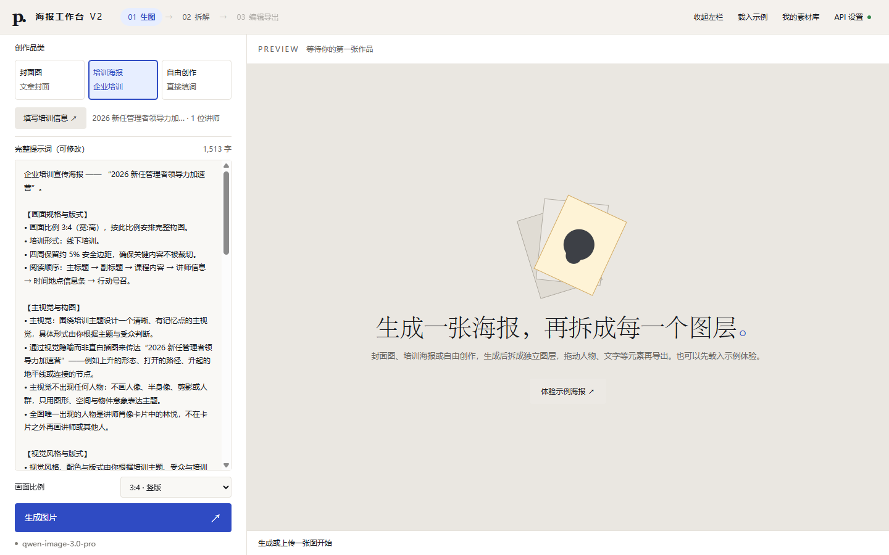
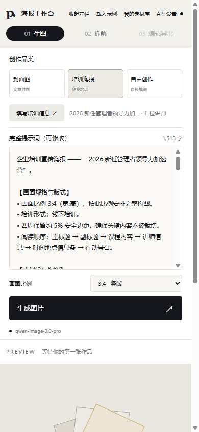
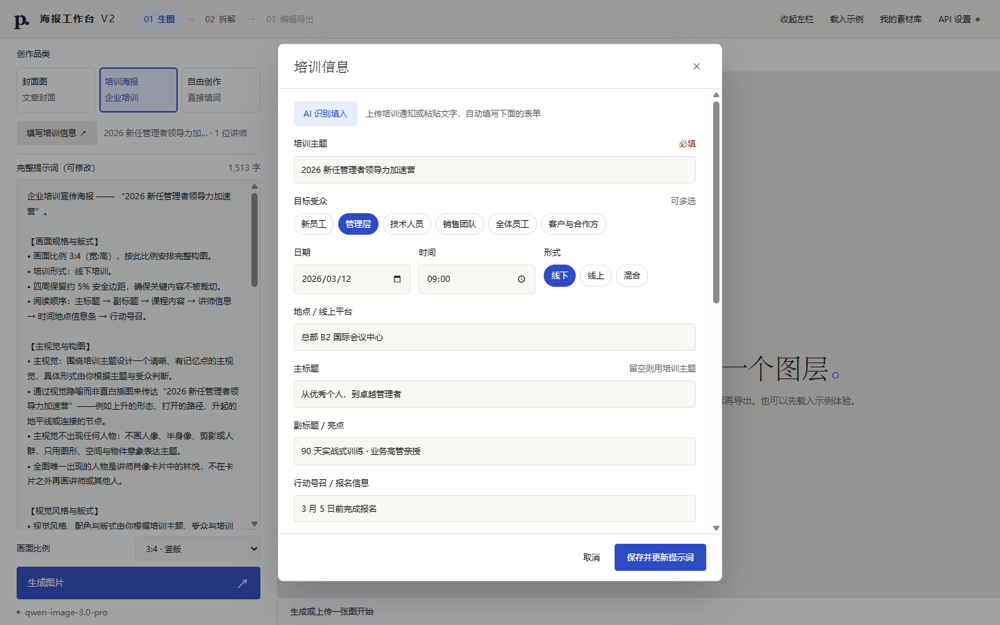

# 界面优化记录

2026-11-25 对海报工作台做了一次界面诊断，并完成了其中 P0 级（直接影响使用）的五项优化。本文记录诊断结论、每项改了什么、为什么这样改、验证方法，以及还没做的部分。

- 提交：`0eed510`（分支 `ui/p0-polish`）
- 截图：`docs/images/界面优化/`，文件名以 `before-` / `after-` 开头

## 一、诊断方法

参考 [impeccable](https://github.com/pbakaus/impeccable) 的审查思路，从字体、颜色、空间、交互、动效、文案几个维度检查，同时对照它列出的"一看就是 AI 做的界面"特征清单。

> 说明：诊断时本机连不上 GitHub，没有读到该仓库的最新内容，用的是对它规则的已有了解。

诊断依据：在 1440×900 下实际打开三个状态（首屏空状态、载入示例后的编辑态、培训信息弹窗），量取各区域尺寸、文字对比度和字号分布，并检查 `static/style.css`、`static/index.html`。

**总体评价**：底子不错。米白配墨黑，比较克制，没有紫蓝渐变、毛玻璃、发光暗色这类典型的 AI 风格；`prefers-reduced-motion`、`focus-visible`、ARIA 角色、`<dialog>` 都做了。主要问题有三个：编辑态画布被挤得太小；字号和对比度偏低；CSS 层层覆盖，没有统一的设计变量。

| 改前 | 改后 |
| --- | --- |
|  |  |
|  |  |

## 二、P0 完成情况

### 1. 编辑态画布被工具栏挤压

**问题**：画布上方叠了三条栏：标题栏 48px、工具栏 79px（"示例不会保存"的提示把它挤成两行）、样式条 42px，下面还有 40px 底栏。900px 高的屏幕上海报只剩约 530px 高。左栏仍占 400px，显示的却是编辑时用不上的提示词。

**改法**：
- 「＋图片 / ＋文字 / ＋形状」和样式条合成一行工具栏：左边添加按钮，中间是选中对象的样式（`#style-bar` 移进 `#editor-toolbar`），右边「恢复原始图层」。没选中时中间只显示一行短提示。
- 「示例不会保存」改成标题栏里的小标签「改动不会保存」，悬停看完整说明。
- 快捷键提示只留在底栏，不在工具栏重复。
- 进入编辑时自动收起左栏（`collapseForEditor`）；清空画布或回到原图预览时自动展开（`restoreAfterEditor`）。如果是用户自己手动收起的，不会替他打开。
- 素材库直接打开编辑稿时，不再强制展开左栏。

**效果（1440×900）**：

| | 改前 | 改后 |
| --- | --- | --- |
| 画布区高度 | 594px | 710px |
| 海报显示尺寸 | 约 410×530 | 500×646 |
| 画布区宽度 | 约 975px | 1100px |

### 2. 提示消息盖住海报标题

**问题**：`#status` 悬在画布顶部居中，载入示例后正好挡住海报主标题。

**改法**：改成贴在画布底边、横跨画布的消息条。海报四周本来留有 32px 适配边距（`fitStage` 和 `PosterEditor.fit` 都是这个值），消息条高 30px，正好落在这段空白里，任何时候都不会盖住海报。
- 报错是深红底，不会自动消失；普通消息 5 秒后消失（和原来一样）。
- 右侧有 ✕，点消息条任意位置都能关闭。
- 从底边滑上来，用时 0.18 秒；系统开启"减少动画"时不播放。
- 原图预览时右下角的「直接编辑 / 继续拆解图层」按钮，会在消息出现时自动上移（CSS `:has()`）。

**和诊断时建议不同的地方**：诊断时建议放画布左下角。实测发现海报居中且占满高度，左下角同样会压住海报底部的报名信息，所以改成贴着底边。

### 3. 两套导航不同步

**问题**：顶部步骤条不能点击；左栏又有一组「生成 / 拆解」标签页。实测出现过步骤条亮着 03、左栏却停在"生成"的情况。窗口宽度小于 1180px 时步骤条直接隐藏，唯一的进度提示就没了。

**改法**：步骤条改成 `<nav>` 里的三个按钮，成为唯一的导航；左栏标签页删除，两个面板改为 `role="region"`。
- 点 01 / 02：展开左栏，切到对应面板。
- 点 03：编辑器已打开时收起左栏；只有原图预览时等同于「直接编辑」；还没有图时按钮半透明（`aria-disabled`），点了提示"先生成、上传或载入一张图"。
- 高亮由 `updateFlow()` 统一计算：编辑器打开且左栏收起时是 03，否则看左栏面板（生图 = 01，拆解 = 02）。所有改变状态的地方（`setMode`、`showControls`、`hideEditor`、`loadSource`、`openLayers`）都调用它，原来的 `setFlow(n)` 已删除。
- 1180px 以下只隐藏箭头；600px 以下步骤条单独占顶栏第二行（`--top` 变为 94px），三个按钮平分宽度。

| 操作 | 高亮 | 左栏 |
| --- | --- | --- |
| 打开页面 | 01 | 生图面板 |
| 载入示例 | 03 | 收起 |
| 编辑中点 02 | 02 | 拆解面板，编辑器还在 |
| 再点 03 | 03 | 收起 |
| 没有图时点 03 | 01 不变 | 只弹出提示 |

**操作习惯的变化**：以前点左栏的「拆解」标签，现在点顶部的「02 拆解」。

### 4. 字号太小、种类太多

**问题**：全站约 16 种字号，8–11px 的小字有 69 处。中文在 Windows 的微软雅黑下低于 12px 基本看不清。

**改法**：`style.css` 开头定义 7 级字阶，所有字号都只能从中取；CSS 里已经没有写死的像素字号。

| 变量 | 字号 | 用途 |
| --- | --- | --- |
| `--fs-xs` | 12px | 最小字号：说明、标签、元信息 |
| `--fs-sm` | 13px | 按钮、次要正文 |
| `--fs-base` | 14px | 正文 |
| `--fs-md` | 16px | 小标题 |
| `--fs-lg` | 20px | 弹窗标题 |
| `--fs-xl` | 28px | 大标题 |
| `--fs-2xl` | 40px | 空状态主标题 |

映射规则：≤12px → xs，13 → sm，14 → base，15–16 → md，17–22 → lg，23–28 → xl，更大 → 2xl。

### 5. 对比度不达标 + 整体配色

**问题**：次要文字 `#74787f` 在画布底色上只有 3.59:1；步骤条未激活项 2.64:1；锁定图标 1.74:1；禁用按钮用 45% 透明度，几乎看不见。`--green` 实际是墨黑色，`.accent` 用的也是它，所以标题末尾的强调"。"等于没有；红色有三个略有差异的版本；`#fbf3d9` 写死了 6 处。

**改法**：
- 用 OKLCH 推导出一组语义颜色变量，写在 `style.css` 开头，每个变量都注明 OKLCH 原值和用途。写死的颜色只剩阴影用的半透明墨黑。
- 中性色保留暖米白纸张感（色相 85），只把对比度不够的灰调深。
- **强调色只用一个靛蓝 `#2f4bc3`**（OKLCH 0.47 0.19 268），和画布上选中框、吸附线 `#2443e5` 是同一色相。只用在"能点的"和"已选中的"地方：主按钮、当前步骤、选中的品类卡片 / 标签 / 风格卡片 / 图层行、文字加粗开关、所有焦点框。
- 「AI 识别填入」原来是黑底，会和「保存」抢主次，改成浅蓝底。
- API 设置旁的状态点：已连接绿色、未连接琥珀色（原来是黑和灰）。
- 报错红、警告黄各统一成一套。
- 删除名不副实的 `--green`、`--yellow`，以及已无引用的小红书样式。

| 项目 | 改前 | 改后 |
| --- | --- | --- |
| 次要文字放在画布底色上 | 3.59 | 4.85 |
| 步骤条未激活项 | 2.64 | 5.32 |
| 锁定 / 显隐图标 | 1.74 | 3.94（图标标准是 3） |
| 主按钮文字 | — | 7.20 |
| 禁用按钮 | 透明度 45% | 固定浅灰 `--disabled`，2.67:1，看得见但明显不可点 |

**验证**：在 6 个界面（首页、编辑态、培训弹窗、拆解面板、素材库、封面风格弹窗）逐个检查全部 424 处可见文字的实际渲染对比度（计入父元素透明度），除了步骤之间装饰用的"→"（已标 `aria-hidden`），全部达到 4.5:1。

**以后想换强调色**：只改 `--accent`、`--accent-hover`、`--accent-soft`、`--accent-soft-2`、`--accent-line` 这 5 个变量，改完重新核对白字在 `--accent` 上、`--accent` 字在 `--accent-soft` 上都不低于 4.5:1。

## 三、验证方式

- 每一项改完都跑全部测试：`python -m unittest test_server.py test_qwen.py test_extract.py test_edits.py`（56 项）、`node test_training.cjs`、`node test_editor_core.cjs`、`node test_app.cjs`、`node --check static/*.js`，全部通过。
- `test_app.cjs` 删除了针对旧 `setFlow()` 的一句断言，"清空画布后回到生图面板"仍在测。
- 截图和量尺寸：浏览器调试工具（chrome-devtools MCP）当时连接失败，改用本机 Chrome 无头模式，通过 DevTools 协议加载页面、执行操作、读取元素位置并截图。测过 1440×900、1024×768、390×844 三种宽度，均无横向滚动。

## 四、开发时踩到的坑

- **换行符**：仓库里的前端文件是 CRLF。用 Python 读写文件时如果按文本模式处理，会悄悄改成 LF，`git diff` 会显示整个文件都变了（这次 `app.js` 一度显示改了 1558 行）。用二进制读写、或者读入后按原换行写回。另外 Git Bash 里用 `grep -c $'\r$'` 统计 CRLF 不准，要按字节核对。
- **`test_app.cjs` 的切片标记**：改 `app.js` 时，新函数不要放进切片区间，也不要和切片标记同名（见开发规范）。

## 五、还没做的（P1 / P2）

诊断里其余各项已登记到 [问题待办](问题待办.md)。建议顺序：

| 顺序 | 内容 |
| --- | --- |
| 1 | 清理 `style.css` 里对 `.purpose-row`、`.prompt-details` 等的多段重复覆盖（颜色和字号已收敛，布局部分还在） |
| 2 | 空状态插画换成"海报分层爆炸图"：用现有的 `layer-01..08.png` 错开叠放，一眼看懂"生成之后还能拆层" |
| 3 | 提示词默认折叠成一行"提示词已生成 · 1,513 字 · 查看/修改"，培训信息摘要放到最显眼处 |
| 4 | 去掉重复说明：右栏 3 段说明、快捷键提示合并成一个"?"浮层 |
| 5 | 图标统一成一套 SVG（现在混用 ↗ ↓ ⇅ ↺ ✎ 字符；↗ 常被理解为"外部链接"） |
| 6 | 点击区域：编辑态有 35 个控件高度不到 32px |
| 7 | 弹窗打开时焦点落在 ✕ 上，应落在第一个输入框 |
| 8 | 顶栏按钮分主次；「收起左栏」改成左栏边缘的图标 |
| 9 | 中文界面里的英文小标题 PREVIEW / LAYERS 换成中文或删除 |
| 10 | 字体：Windows 上 `Avenir Next`、`Songti SC` 都不存在；明确一款中文衬线只用于大标题，数字加 `tabular-nums` |
| 11 | 原图预览时右下角两个按钮压在海报右下角（改动前就有） |
| 12 | 动效：弹窗、抽屉 150–250ms 减速过渡；生成等待加分阶段进度；补 favicon |
