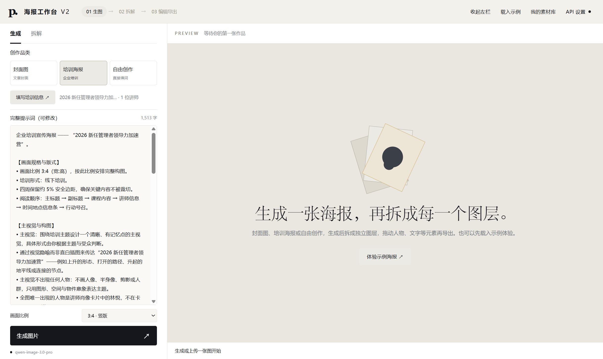
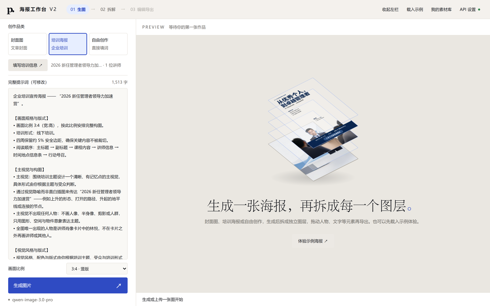
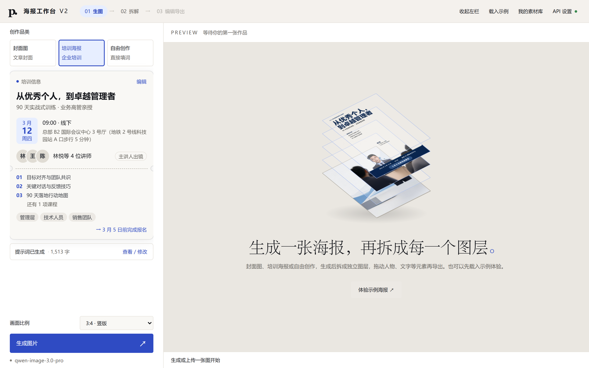
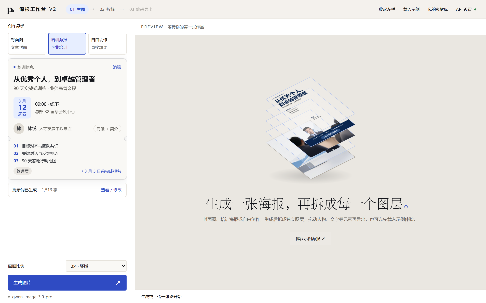

# 界面优化记录

2026-11-25 对海报工作台做了一次界面诊断，并完成了其中 P0 级（直接影响使用）的五项优化。本文记录诊断结论、每项改了什么、为什么这样改、验证方法，以及还没做的部分。

- 提交：P0 `0eed510`（分支 `ui/p0-polish`）；P1 第 1–5 项见[第六节](#六p1-进度)（分支 `ui/p1-polish`）
- 截图：`docs/images/界面优化/`，文件名以 `before-` / `after-` 开头

## 一、诊断方法

参考 [impeccable](https://github.com/pbakaus/impeccable) 的审查思路，从字体、颜色、空间、交互、动效、文案几个维度检查，同时对照它列出的"一看就是 AI 做的界面"特征清单。

> 说明：诊断时本机连不上 GitHub，没有读到该仓库的最新内容，用的是对它规则的已有了解。

诊断依据：在 1440×900 下实际打开三个状态（首屏空状态、载入示例后的编辑态、培训信息弹窗），量取各区域尺寸、文字对比度和字号分布，并检查 `static/style.css`、`static/index.html`。

**总体评价**：底子不错。米白配墨黑，比较克制，没有紫蓝渐变、毛玻璃、发光暗色这类典型的 AI 风格；`prefers-reduced-motion`、`focus-visible`、ARIA 角色、`<dialog>` 都做了。主要问题有三个：编辑态画布被挤得太小；字号和对比度偏低；CSS 层层覆盖，没有统一的设计变量。

| 改前 | 改后 |
| --- | --- |
|  |  |
|  |  |

## 二、P0 完成情况

### 1. 编辑态画布被工具栏挤压

**问题**：画布上方叠了三条栏：标题栏 48px、工具栏 79px（"示例不会保存"的提示把它挤成两行）、样式条 42px，下面还有 40px 底栏。900px 高的屏幕上海报只剩约 530px 高。左栏仍占 400px，显示的却是编辑时用不上的提示词。

**改法**：
- 「＋图片 / ＋文字 / ＋形状」和样式条合成一行工具栏：左边添加按钮，中间是选中对象的样式（`#style-bar` 移进 `#editor-toolbar`），右边「恢复原始图层」。没选中时中间只显示一行短提示。
- 「示例不会保存」改成标题栏里的小标签「改动不会保存」，悬停看完整说明。
- 快捷键提示只留在底栏，不在工具栏重复。
- 进入编辑时自动收起左栏（`collapseForEditor`）；清空画布或回到原图预览时自动展开（`restoreAfterEditor`）。如果是用户自己手动收起的，不会替他打开。
- 素材库直接打开编辑稿时，不再强制展开左栏。

**效果（1440×900）**：

| | 改前 | 改后 |
| --- | --- | --- |
| 画布区高度 | 594px | 710px |
| 海报显示尺寸 | 约 410×530 | 500×646 |
| 画布区宽度 | 约 975px | 1100px |

### 2. 提示消息盖住海报标题

**问题**：`#status` 悬在画布顶部居中，载入示例后正好挡住海报主标题。

**改法**：改成贴在画布底边、横跨画布的消息条。海报四周本来留有 32px 适配边距（`fitStage` 和 `PosterEditor.fit` 都是这个值），消息条高 30px，正好落在这段空白里，任何时候都不会盖住海报。
- 报错是深红底，不会自动消失；普通消息 5 秒后消失（和原来一样）。
- 右侧有 ✕，点消息条任意位置都能关闭。
- 从底边滑上来，用时 0.18 秒；系统开启"减少动画"时不播放。
- 原图预览时右下角的「直接编辑 / 继续拆解图层」按钮，会在消息出现时自动上移（CSS `:has()`）。

**和诊断时建议不同的地方**：诊断时建议放画布左下角。实测发现海报居中且占满高度，左下角同样会压住海报底部的报名信息，所以改成贴着底边。

### 3. 两套导航不同步

**问题**：顶部步骤条不能点击；左栏又有一组「生成 / 拆解」标签页。实测出现过步骤条亮着 03、左栏却停在"生成"的情况。窗口宽度小于 1180px 时步骤条直接隐藏，唯一的进度提示就没了。

**改法**：步骤条改成 `<nav>` 里的三个按钮，成为唯一的导航；左栏标签页删除，两个面板改为 `role="region"`。
- 点 01 / 02：展开左栏，切到对应面板。
- 点 03：编辑器已打开时收起左栏；只有原图预览时等同于「直接编辑」；还没有图时按钮半透明（`aria-disabled`），点了提示"先生成、上传或载入一张图"。
- 高亮由 `updateFlow()` 统一计算：编辑器打开且左栏收起时是 03，否则看左栏面板（生图 = 01，拆解 = 02）。所有改变状态的地方（`setMode`、`showControls`、`hideEditor`、`loadSource`、`openLayers`）都调用它，原来的 `setFlow(n)` 已删除。
- 1180px 以下只隐藏箭头；600px 以下步骤条单独占顶栏第二行（`--top` 变为 94px），三个按钮平分宽度。

| 操作 | 高亮 | 左栏 |
| --- | --- | --- |
| 打开页面 | 01 | 生图面板 |
| 载入示例 | 03 | 收起 |
| 编辑中点 02 | 02 | 拆解面板，编辑器还在 |
| 再点 03 | 03 | 收起 |
| 没有图时点 03 | 01 不变 | 只弹出提示 |

**操作习惯的变化**：以前点左栏的「拆解」标签，现在点顶部的「02 拆解」。

### 4. 字号太小、种类太多

**问题**：全站约 16 种字号，8–11px 的小字有 69 处。中文在 Windows 的微软雅黑下低于 12px 基本看不清。

**改法**：`style.css` 开头定义 7 级字阶，所有字号都只能从中取；CSS 里已经没有写死的像素字号。

| 变量 | 字号 | 用途 |
| --- | --- | --- |
| `--fs-xs` | 12px | 最小字号：说明、标签、元信息 |
| `--fs-sm` | 13px | 按钮、次要正文 |
| `--fs-base` | 14px | 正文 |
| `--fs-md` | 16px | 小标题 |
| `--fs-lg` | 20px | 弹窗标题 |
| `--fs-xl` | 28px | 大标题 |
| `--fs-2xl` | 40px | 空状态主标题 |

映射规则：≤12px → xs，13 → sm，14 → base，15–16 → md，17–22 → lg，23–28 → xl，更大 → 2xl。

### 5. 对比度不达标 + 整体配色

**问题**：次要文字 `#74787f` 在画布底色上只有 3.59:1；步骤条未激活项 2.64:1；锁定图标 1.74:1；禁用按钮用 45% 透明度，几乎看不见。`--green` 实际是墨黑色，`.accent` 用的也是它，所以标题末尾的强调"。"等于没有；红色有三个略有差异的版本；`#fbf3d9` 写死了 6 处。

**改法**：
- 用 OKLCH 推导出一组语义颜色变量，写在 `style.css` 开头，每个变量都注明 OKLCH 原值和用途。写死的颜色只剩阴影用的半透明墨黑。
- 中性色保留暖米白纸张感（色相 85），只把对比度不够的灰调深。
- **强调色只用一个靛蓝 `#2f4bc3`**（OKLCH 0.47 0.19 268），和画布上选中框、吸附线 `#2443e5` 是同一色相。只用在"能点的"和"已选中的"地方：主按钮、当前步骤、选中的品类卡片 / 标签 / 风格卡片 / 图层行、文字加粗开关、所有焦点框。
- 「AI 识别填入」原来是黑底，会和「保存」抢主次，改成浅蓝底。
- API 设置旁的状态点：已连接绿色、未连接琥珀色（原来是黑和灰）。
- 报错红、警告黄各统一成一套。
- 删除名不副实的 `--green`、`--yellow`，以及已无引用的小红书样式。

| 项目 | 改前 | 改后 |
| --- | --- | --- |
| 次要文字放在画布底色上 | 3.59 | 4.85 |
| 步骤条未激活项 | 2.64 | 5.32 |
| 锁定 / 显隐图标 | 1.74 | 3.94（图标标准是 3） |
| 主按钮文字 | — | 7.20 |
| 禁用按钮 | 透明度 45% | 固定浅灰 `--disabled`，2.67:1，看得见但明显不可点 |

**验证**：在 6 个界面（首页、编辑态、培训弹窗、拆解面板、素材库、封面风格弹窗）逐个检查全部 424 处可见文字的实际渲染对比度（计入父元素透明度），除了步骤之间装饰用的"→"（已标 `aria-hidden`），全部达到 4.5:1。

**以后想换强调色**：只改 `--accent`、`--accent-hover`、`--accent-soft`、`--accent-soft-2`、`--accent-line` 这 5 个变量，改完重新核对白字在 `--accent` 上、`--accent` 字在 `--accent-soft` 上都不低于 4.5:1。

## 三、验证方式

- 每一项改完都跑全部测试：`python -m unittest test_server.py test_qwen.py test_extract.py test_edits.py`（56 项）、`node test_training.cjs`、`node test_editor_core.cjs`、`node test_app.cjs`、`node --check static/*.js`，全部通过。
- `test_app.cjs` 删除了针对旧 `setFlow()` 的一句断言，"清空画布后回到生图面板"仍在测。
- 截图和量尺寸：浏览器调试工具（chrome-devtools MCP）当时连接失败，改用本机 Chrome 无头模式，通过 DevTools 协议加载页面、执行操作、读取元素位置并截图。测过 1440×900、1024×768、390×844 三种宽度，均无横向滚动。

## 四、开发时踩到的坑

- **换行符**：仓库里的前端文件是 CRLF。用 Python 读写文件时如果按文本模式处理，会悄悄改成 LF，`git diff` 会显示整个文件都变了（这次 `app.js` 一度显示改了 1558 行）。用二进制读写、或者读入后按原换行写回。另外 Git Bash 里用 `grep -c $'\r$'` 统计 CRLF 不准，要按字节核对。
- **`test_app.cjs` 的切片标记**：改 `app.js` 时，新函数不要放进切片区间，也不要和切片标记同名（见开发规范）。

## 五、还没做的（P1 / P2）

诊断里其余各项已登记到 [问题待办](问题待办.md)。建议顺序：

| 顺序 | 内容 |
| --- | --- |
| ~~1~~ | ~~清理 `style.css` 里的多段重复覆盖~~ 已完成，见第六节 |
| ~~2~~ | ~~空状态插画换成"海报分层爆炸图"~~ 已完成，见第六节 |
| ~~3~~ | ~~提示词默认折叠成一行，培训信息摘要放到最显眼处~~ 已完成，见第六节 |
| ~~4~~ | ~~去掉重复说明，快捷键合并成一个浮层~~ 已完成，见第六节 |
| ~~5~~ | ~~图标统一成一套 SVG~~ 已完成，见第六节 |
| 6 | 点击区域：编辑态有 35 个控件高度不到 32px |
| 7 | 弹窗打开时焦点落在 ✕ 上，应落在第一个输入框 |
| 8 | 顶栏按钮分主次；「收起左栏」改成左栏边缘的图标（手机宽度下已隐藏，见第六节） |
| 9 | 中文界面里的英文小标题 PREVIEW / LAYERS 换成中文或删除 |
| 10 | 字体：Windows 上 `Avenir Next`、`Songti SC` 都不存在；明确一款中文衬线只用于大标题，数字加 `tabular-nums` |
| 11 | 原图预览时右下角两个按钮压在海报右下角（改动前就有） |
| 12 | 动效：弹窗、抽屉 150–250ms 减速过渡；生成等待加分阶段进度；补 favicon |

## 六、P1 进度

### 1. 样式表重复覆盖清理（`91b59d8`）

**问题**：生图面板的样式被叠了五层：「Generation」「Creation categories」「Four independent prompt editors」三段，再加三个媒体查询。`.purpose-row`、`.category-button`、`.prompt-details`、提示词输入框、`.generation-footer`、`.model-line`、`.controls` 和 `--left` 各被设了 2–5 次；有些媒体查询里的值随后又被一条不带条件的规则盖掉，等于没写。想改一个间距，得先在五个地方里找出真正生效的那条。

**改法**：按原来的层叠顺序算出每个属性最终生效的值，合成一个「生图面板」块，每个选择器只写一次，另外只留 `≤900px` 和 `≥901px` 两个小媒体查询。同时删掉已经没有元素会用到的规则：`.generation-settings`、`.settings-content`、`.prompt-details>summary` / `[open]`（它是 `<section>` 不是 `
`）、`.short-text`、`.next-step`（只用了同名 id）、`.chip.selected`、`.scale-control`、`.layer-order-tools`、`#composition`、`#apply-punk`、`.storage-note`。

**验证**：这一步应该"什么都不变"，所以没靠肉眼看，而是用无头 Chrome 对 17 个状态（5 种窗口宽度、生图 / 拆解面板、编辑态、原图预览、培训弹窗、封面弹窗、API 设置、素材库）里全部 8,785 个可见元素，记录位置、尺寸和 42 项计算样式，改前改后逐项比对。先连跑两次改前版本确认结果稳定（0 处差异），改后唯一的差异是 `.purpose-row` 的 `flex-wrap`：它是网格布局，这个属性本来就不起作用。

### 2. 空状态插画：海报分层爆炸图

**问题**：原来的插画是三张歪斜的纸，上面一个黑色圆团，看不出和"拆图层"有什么关系。

**改法**：把示例海报的图层按真实的叠放顺序，斜着叠成一摞并拉开间距，一眼就能看出"一张海报是由好几层叠出来的"。
- 8 个图层里有几个内容太少（一行字、一个按钮），缩小后看不清，所以合成了 5 层，从下到上：背景、讲师、听众、信息栏（原 5+2+1）、标题文字（原 4+3）。
- 图片放在 `static/empty-art/`，是从 `layer-01..08.png` 缩到 280px 宽生成的，背景用 JPEG，其余用带透明的 PNG，5 张共约 230 KB。没用 WebP：服务用 `mimetypes` 判断类型并开了 `nosniff`，老版本 Python 不一定认识 `.webp`。
- 透明的几层画成淡蓝细边框的"玻璃片"，边框颜色用强调色系的 `--accent-line`。
- 动效：页面打开时几层先叠在一起，然后依次升起拉开，每层错开 60ms，用时 0.9 秒，只播一次。开启"减少动画"时直接显示拉开后的样子。
- 屏幕高度不到 760px 时整体缩小。
- 全部用 CSS 3D 变换实现，没有加脚本，也没有内联样式（页面安全策略不允许）。

**注意**：
- 插画用的是示例海报里的讲师人像。[问题待办 · 待决策](问题待办.md#待决策)第 2 条（示例按真人照片生成，对外分发前要确认本人同意）现在也覆盖首页。如果换掉示例，要用新示例的图层重新生成 `static/empty-art/`。
- 本机 Windows 关闭了"动画效果"，Chrome 会报告"减少动画"，所以在这台电脑上看到的是静止的拉开状态，看不到升起的动画；P0 里消息条的滑入动画也一样。这是预期行为。

**验证**：截图检查了 1440×900、1280×720、390×844 三种尺寸；分别在"减少动画"和正常模式下读取每层的实际位置，确认动画从叠在一起开始、2 秒后到达终点，减少动画时一开始就在终点。再用快照比对确认：除了插画本身和它下方文字的位置，其他元素没有任何变化。

### 顺带修复：手机宽度下顶栏挤成三行

P0 第 4 项把最小字号提到 12px 后，手机宽度下顶栏的四个按钮总宽 266px，加上品牌名共 393px，在 390px 宽的屏幕上放不下，被挤到第二行，步骤条又被挤出 94px 高的顶栏，压在下面的面板上。P0 当时的手机截图是在改字号之前截的，所以没发现。

改法：手机宽度（≤600px）下隐藏「收起左栏」。手机上页面本来就是上下排列，点「01」「02」也会展开左栏，这个按钮用处不大。现在宽度降到 360px，品牌名和按钮仍在同一行。

### 3. 提示词折叠成一行，培训信息卡片放到最显眼处

**问题**：生图面板大半屏是 1,513 字的提示词。对 HR / 培训部门来说，提示词是实现细节，他们真正要核对的是"海报上会写什么"，而这些信息只缩成了按钮旁一行灰字（"2026 新任管理者领导力加... · 1 位讲师"）。

**改法**：
- 原来的"按钮 + 一行摘要"换成**信息卡片**：主标题（没填就用主题）、副标题，以及时间（含形式）、地点、受众、讲师（含呈现方式）、课程、号召几行；空的行不显示，每行最多两行，鼠标悬停看全文。右上角「编辑」打开培训弹窗。
- 弹窗拼出的提示词**默认折叠成一行**："提示词已生成 · 1,513 字　查看 / 修改"。展开后从开头显示，按钮变成「收起」。手改过的显示"提示词已手动修改"。"重新拼装"提示条在折叠时照样显示。
- 封面图同样处理：选了风格时卡片显示标题、风格和补充描述，提示词折叠；"不套风格"时卡片提示"直接在下方写画面描述"，提示词框保持展开。
- 自由创作、没选风格的封面、还没填的培训表单，提示词要靠用户自己写，提示词框始终展开。
- 屏幕高度不到 820px 的桌面上，展开提示词时卡片只留标题，保证「生成图片」按钮不被挤出屏幕（1280×600 到 1440×900 都测过）。

**代码**：
- 卡片内容由纯函数 `TrainingPoster.brief(values)` 生成，和 `compile()` 用同一套规则（标题回退到主题、只算会画进海报的讲师），所以卡片和提示词不会对不上；`test_training.cjs` 先写测试再实现。
- `app.js` 的 `countPrompt()` 改为 `renderPrompt()`：除了字数，还负责标题文字、折叠状态和「查看 / 修改」按钮；`renderBrief()` 取代原来的 `settingsSummary()`。
- 删除了只给那一行摘要用的 `TrainingForm.summary()` 及其测试（同一条规则现在由 `brief` 的测试覆盖）。

#### 3b. 信息卡片改成"活动票根"（用户反馈：信息过密、不够突出、不够有设计感）

第一版卡片是"标签 + 文字"六行列表，每行分量一样，看不出重点。改成活动票根的样子，让版式本身表达信息类型，去掉"时间 / 地点"这类字段标签：

- **主标题**用 20px 粗体（和海报本身的粗黑标题呼应），副标题在下面用浅色。
- **日期做成日历块**：强调色底，"3 月 / 12 / 周四"，旁边是时间、形式和地点。日期填的不是标准格式时，按原文放在时间那一行。
- **讲师**每人一行头像 + 姓名 + 头衔，头像用上传的肖像，没有肖像就显示姓的首字；呈现方式（肖像 + 简介等）是右侧的小标签。三位以上合成一行叠放的头像和"林悦等 4 位讲师"，悬停看全部。
- **票根虚线**（两侧半圆缺口）以下是次要信息：课程编号列表（最多 3 条，多出的显示"还有 N 项课程"）、受众小标签、强调色的行动号召。
- 封面卡片同样处理：标题 + 所选风格的缩略图；补充描述放在票根下。
- 缺口用 CSS `mask` 切出，外轮廓和阴影用父元素的 `drop-shadow`，所以阴影会沿着缺口走。
- **短屏幕**：卡片内容多时，左栏中间部分滚动，「画面比例 + 生成图片」固定在底部，上方有一道淡出过渡；1280×600 到 1440×900 都测过按钮在屏幕内。展开提示词时卡片只留标题（之前已有）。
- `TrainingPoster.brief()` 改为返回结构化字段（`date`、`when`、`venue`、`audiences`、`mode`、`speakers[].index`、`courses`、`cta`），测试先改再实现，新增日期解析（含 2 月 30 日这类无效日期）的用例。

### 4. 说明文字合并成「快捷键」面板

**问题**：编辑态有四处说明：右栏顶部的拖动 / 右键提示（一直显示）、右栏底部的拆层说明、导出尺寸下的铺满 / 留白说明（一直显示）、画布底栏一长串快捷键（而且不全：复制、粘贴、删除、微调都没写）。

**改法**：
- 画布底栏右侧换成一个小按钮「快捷键 ?」，点开是「操作与快捷键」面板，分画布、编辑、图层列表三组，按键画成键帽。编辑时按 `?` 也能打开或关闭；在输入框里打字时不触发。面板用浏览器原生的 `popover`，按 Esc 或点外面就关。
- 删除右栏顶部的拖动 / 右键提示：拖动手柄本来就有悬停提示，右键说明进了面板。
- 导出尺寸的说明只在选了"原图尺寸"以外的比例时显示。
- 右栏底部的拆层说明保留：它随内容变化（示例背景有文字残影、拆出的文字是像素图），是有用的上下文信息。
- 离开编辑态（清空画布、回到原图预览）时，按钮隐藏，面板关闭。

**验证**：按钮打开、`?` 打开再关闭、在输入框里按 `?` 不打开、比例说明随选择出现和消失、清空画布后面板关闭，都用无头 Chrome 跑过；1440×900、1024×768 下面板完整显示，1280×600 下面板内部滚动。

### 5. 图标统一成一套 SVG

**问题**：按钮上的图标是各种字符拼的：↗（生成、拆解、体验示例，但 ↗ 通常表示"外部链接"）、↓（下载、导出）、⇅ ↺ ✎ → ✕ ▾ 和全角＋。它们来自不同字体，粗细、大小、基线都对不上；只有图层列表的眼睛、锁、下载是真正的 SVG。

**改法**：
- `index.html` 开头放一份图标集（`<symbol id="i-…">`），用图层列表原有图标的画法：24 格、1.6 线宽、圆头圆角，颜色跟随文字。共 14 个：eye、eye-off、lock、unlock、download、arrow-right、swap、reset、pencil、close、plus、chevron-right、external。
- 用法：`<svg class="icon" aria-hidden="true"><use href="#i-download"/></svg>`。图层列表也改成引用这份图标集，不再自带一套。
- 动作按钮（生成图片、拆解、体验示例、继续拆解）用 →；下载类图标放在文字前面；只有真正跳到外部网站的「Punk Skill」用外链图标。
- CSS 伪元素里的 ✕（消息条关闭）、▾（样式条下拉）、→（行动号召）没法引用图标集，改成同样形状的 SVG 遮罩（`--i-close` 等变量），颜色仍跟随文字。
- 「＋形状」是下拉框，选项里放不了图标，所以把加号放在包住下拉框的 label 里。
- 快捷键面板里的 ↑ ↓ ← → 是按键名，保留字符。

**验证**：在首页、拆解面板、编辑态逐个检查每个 `<use>` 都能找到对应图标、渲染尺寸不为零；截图看了编辑态、原图预览、培训弹窗。
